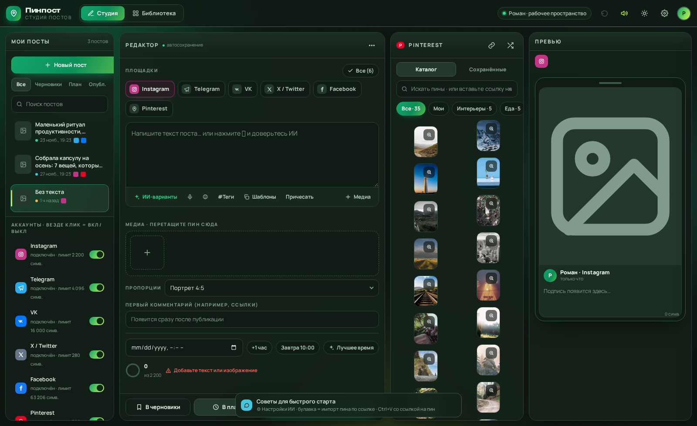
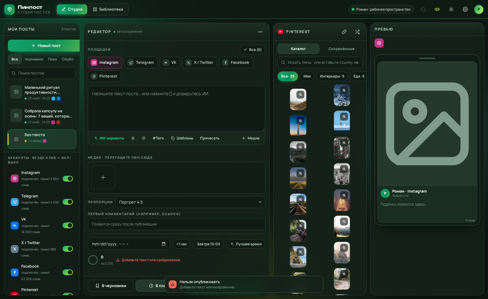
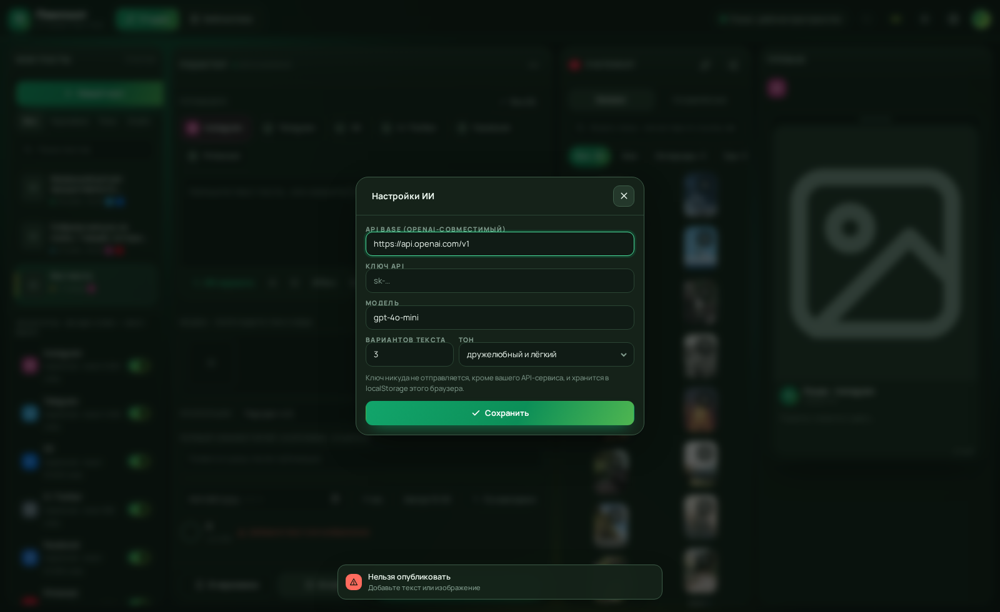
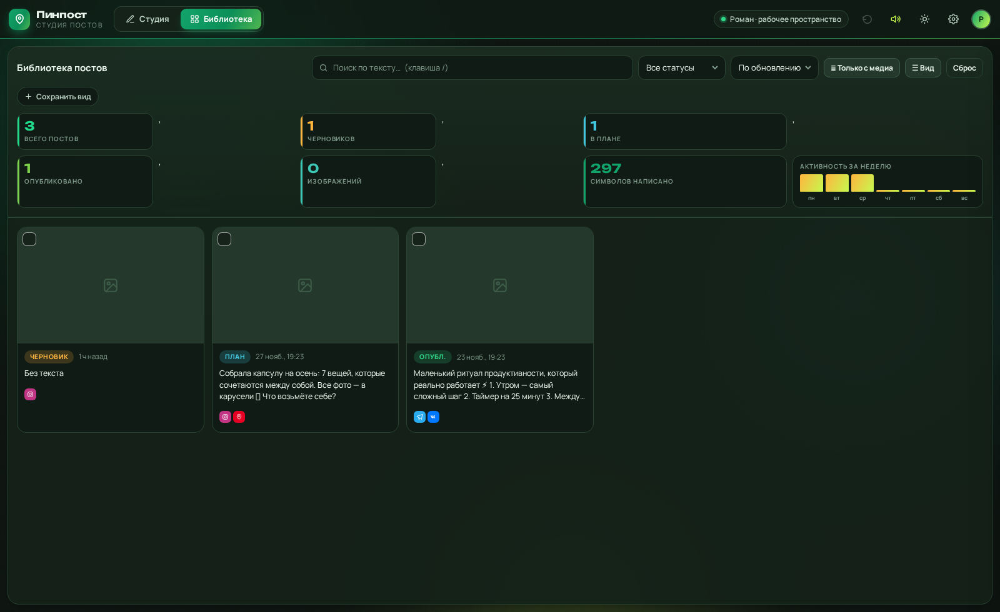

# 🌿 Пинпост

Тёмная студия постов для соцсетей в зелёных оттенках, с Pinterest прямо в панели,
masonry-галереей пинов, ИИ-генерацией текста и публикацией **везде одним кликом**.
Один файл `index.html` — без сборки и зависимостей.



## Возможности

- 📌 **Pinterest уже в панели** — отдельная колонка каталога пинов открыта всегда:
  masonry-лента по категориям, поиск, вкладка «Мои», кнопка импорта в шапке.
  Импорт пина по ссылке работает четырьмя способами: кнопка «Импорт пина»,
  вставка URL в поиск, Ctrl+V из буфера в любом месте, drag & drop ссылки в редактор.
- 🚀 **«Опубликовать везде»** — одна кнопка публикует пост сразу во все подключённые
  площадки (Instagram, Telegram, VK, X, Facebook, Pinterest). Переключатель
  «Все (N)» выбирает все аккаунты разом; лимиты символов и картинок по площадкам
  учитываются автоматически, результат — с конфетти и списком площадок в тосте.

  
- ✍️ **Редактор с живым превью** под каждую площадку (симуляция карточки Instagram/Pinterest
  и лент Facebook, пузырька Telegram/VK, обрезки X) + счётчик-кольцо символов.
- ✨ **ИИ-варианты текста** — несколько вариантов за запрос, включая генерацию по картинке
  (vision). Подходит любой OpenAI-совместимый API: base URL, ключ, модель, число вариантов
  и тон настраиваются в настройках и хранятся локально.

  
- 🎙 **Голосовой ввод** (dictation, ru-RU) — надиктуйте текст в редактор кнопкой с микрофоном.
- ⏰ **«Лучшее время»** — чип подставляет удачное время публикации в один клик.
- 🗂 **Библиотека** — все посты со статистикой, поиском, фильтрами, видами, массовыми
  действиями (дублировать/опубликовать/удалить) и drag & drop сортировкой.

  
- 🖼 **Drag & Drop**: пины из каталога летят в пост анимацией, порядок картинок меняется
  перетаскиванием, файлы с устройства загружаются кнопкой или броском. Alt-текст,
  обложка и пропорции (1:1, 4:5, 16:9) настраиваются на каждое изображение.
- 💾 **Черновики и автосохранение** в localStorage, отмена действий (Ctrl+Z), экспорт JSON.
- 🌗 Тёмная и светлая темы, звуки-отклики, горячие клавиши (Ctrl+Enter — опубликовать,
  `/` — поиск).

## Запуск

Откройте `index.html` в браузере — ничего устанавливать не нужно.

```bash
# или через локальный сервер (для некоторых clipboard API)
python3 -m http.server 8000
```

## Настройка ИИ

Настройки → укажите API Base URL (например `https://api.openai.com/v1`),
ключ и модель (`gpt-4o-mini`, `deepseek-chat`, локальная модель и т.п.).
Без ключа всё остальное работает: каталог пинов, импорт, превью, публикация.
